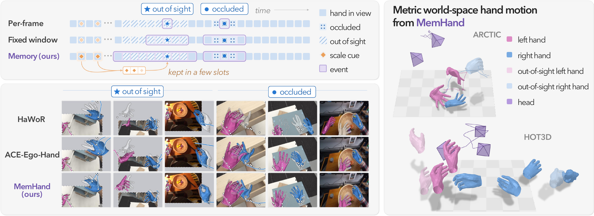

# MemHand
This is the official implementation for our paper:

MemHand: Memory-Enhanced World-Space Hand Motion Reconstruction from Egocentric Videos [arXiv](https://arxiv.org/abs/2611.32876) [Project Page](https://irmvlab.github.io/memhand.github.io/)

Junyi Ma, [Zhangshuo Qi](https://github.com/QiZS-BIT), Erhang Zhang, Mingjie Li, Hesheng Wang*



MemHand reconstructs the metric world-space motion of both hands from egocentric video. It keeps a short-term memory of each occlusion and each out-of-sight event, and a long-term memory of the metric scale, so that every frame can draw on temporal context of the length it actually needs.

The code will be released soon :smile:.

If you find this project useful for your research, please consider citing:
```
@article{ma2026memhand,
  title = {MemHand: Memory-Enhanced World-Space Hand Motion Reconstruction from Egocentric Videos},
  author = {Ma, Junyi and Qi, Zhangshuo and Zhang, Erhang and Li, Mingjie and Wang, Hesheng},
  journal = {arXiv preprint arXiv:2611.32876},
  year = {2026}
}
```
